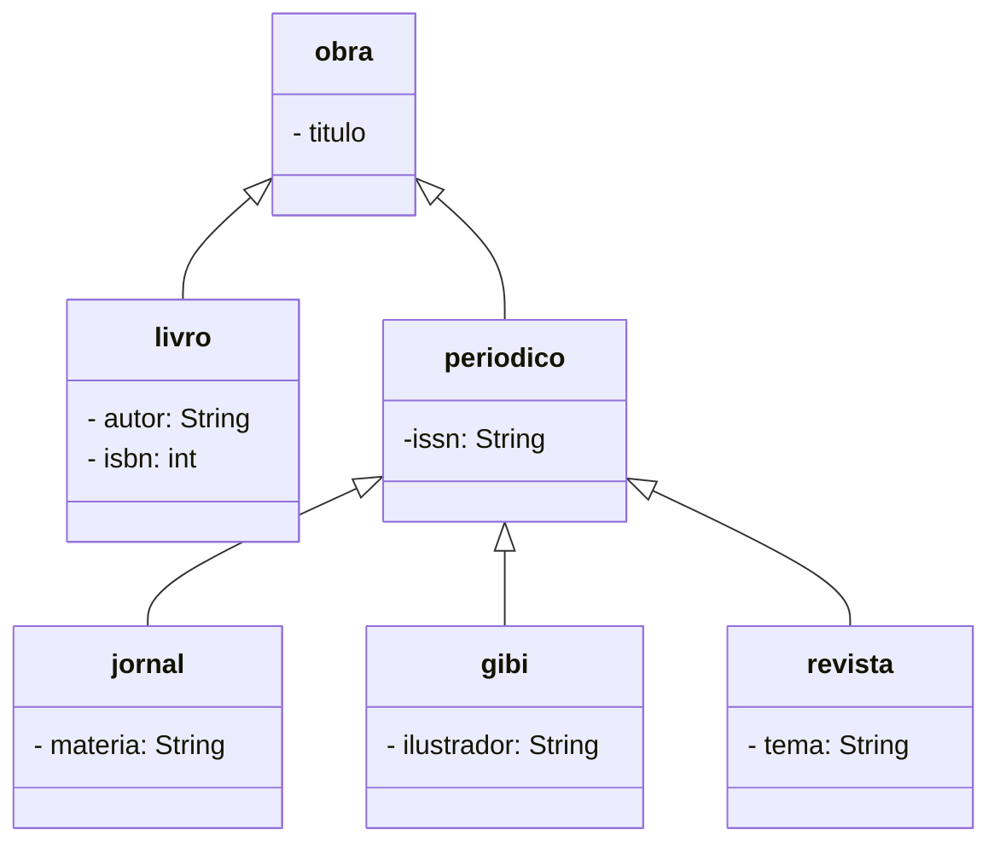
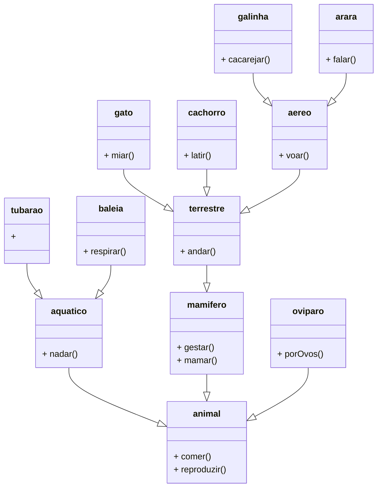

 ```mermaid
    classDiagram
        class Telefone{
            
        }

    class Dimensao{

        }

    class SemFio{

        }

```

 ```mermaid
    classDiagram
        
        direction BT
        
        class Humano{ 
            - nome: String
        }
        class Diretor{
             - Despesas ArrayList<ContasEscola>
        }
        
        class Coordenador{
            - cargo: String
        }
        
        class Professor{
            
        }
        
        class Aluno{
            - matricula: String
            - nome: String
            - disciplinas: ArrayList<Disciplina>
            - listaNotas: ArrayList<notasAlunos>
        }
        
        class Disciplina{
            - nome: String
        }
        
        Professor "1" --|> Humano
        Aluno "1" --|> Humano
        Aluno "0..* "--o "0..*" Disciplina
        Coordenador --|> Humano
        Diretor --|> Coordenador
        Disciplina "1" --o "0..*" Professor

```




